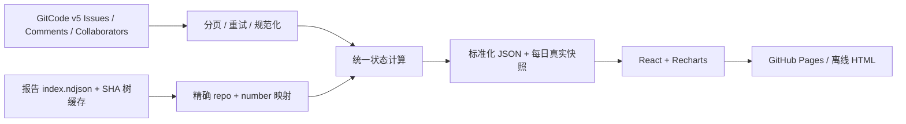

# 架构和真实接口调研

## 技术选择

### 私有责任田查询

`#/duty` 与 Issue 工作台共用导航，但数据独立加载。`DutyView.tsx` 从固定的 GitHub 私有 Contents API
读取数据，或通过 File API 导入本地 JSON；`duty.ts` 校验结构、归一化路径并在浏览器内执行匹配。
精确归属使用目录边界和最长前缀，模糊查询保留全部候选，配置冲突不擅自挑选单一责任人。
文件索引由 `scripts/sync_duty.py` 在私有仓库生成，公开仓库仅包含通用代码及合成人员测试数据。
GitHub fine-grained token 需要目标仓库 Contents 只读权限，不持久保存；刷新、退出页面或清除数据后需重新加载。
不新增公开数据接口，不把私有数据混入 Issue 导出、采集任务、邮件或 Pages artifact。
发布校验拒绝 `public/` 中包含责任田结构的 JSON。

React + TypeScript + Vite：静态构建和 Hash 路由，GitHub Pages 子路径兼容。Recharts：SVG 图表，浏览器可视化与独立 HTML 导出共用图形。原生 CSS：统一深色主题与响应式布局，无额外组件运行时。Python 标准库：认证、JSON、时间和网络无需额外依赖；单一模型产生所有统计。

## 2026-10-15 调研

阅读参考仓库 `collector.py` 的 `_fetch_repo_issues`、`issue_response_notify.py`、`index.html` 与 `.github/workflows/`。参考项目是静态 HTML/CSS/JS + 图表，Python 采集，Actions 发布。它的 Issue 采集使用 v5 state=all / page / per_page，并识别 `finished_at`、`assignees`。本项目保留完整带时区时间，不沿用按日期截断；有效回复要求成员身份，不沿用“非作者即回复”。

实测基础 URL `https://api.gitcode.com/api/v5/repos/`，请求头 `Authorization: Bearer <token>` 可用。

| 接口 | 实测结构与处理 |
|---|---|
| `{repo}/issues?state=all&page=1&per_page=100` | 数组；number 为字符串；state=open/closed；user、assignees、labels、comments、issue_state、priority；created_at/updated_at 为 +08:00；finished_at 可为空 |
| `{repo}/issues/{number}/comments` | 数组；user.login、created_at、body、id；不假定返回顺序，按时间排序 |
| `{repo}/collaborators` | 数组；login/username、access_level、permission；只选 >=15（含 GitCode 的生态开发者）或 admin/write；不持久化 email 等无关字段 |
| `{report_repo}/git/trees/{ref}` | 对象含 tree；**默认只有 20 项**；page/per_page 生效；SHA 子树返回相对路径 |
| `{report_repo}/contents/index.ndjson` | Base64 content + sha；每行明确 repo、number、path、finished_at |

实测 future since=2099-01-01 返回空数组，增量过滤生效；state=all 含 Open 与 Closed。分页优先依据 total_count 验证完整性，没有总数则继续查询至空页，避免服务端缩小 per_page 导致截断。重复 id/page 立即失败，保留之前快照。sort=updated + direction=asc 与一小时窗口降低分页期间活动造成遗漏的风险，七天全量校验最终纠偏。

## 数据模型

`public/data/dashboard.json` schema_version=1：

- generated_at：本次计算时间；last_success：四仓最近成功时刻的最早值（全局数据至少新鲜到该时间）。
- repositories[repo]：issues、stats、last_success、last_full、mode、warnings、error。
- Issue：id=`repo#number`、repo、number、title、body、author、assignees[]、state、created_at、updated_at、closed_at、labels、source_status、priority、comments[]、comments_complete、reply_status、first_reply_at、reports[]、events[]、metrics。
- owners：按人汇总统计及 Issue id、仓库分布；stats：全局同口径汇总。
- report_index：精确身份到最新优先的报告数组；report_success：索引最近成功时间。
- snapshots：365 天每日完整采集统计；activity：真实创建/关闭日期分组。

明确标记 confidential 等非公共记录在规范化前过滤；若旧公共记录被改为非公共，下一次发现该变化时移除。公开静态历史无法追溯撤回已经发布过的内容，因此仅应监控长期公开的问题。API 不可信字段缺失时拒绝该仓库事务，不用空值替代真实状态。评论与成员请求单独降级为未知或已验证证据，并显示警告。闭环事实只取 Issue 接口，绝不由 AI 结果推断。

## AI 报告策略

先读取根目录 index.ndjson 的 SHA；只有变化才读取其文本。按 manifest 中完整仓库路径与编号匹配，明确排除 other/ge 等名称相同的仓库。目录别名 tf_adapter 不用作仓库依据。沿相关目录的 SHA 树验证 report.md 存在，忽略 files/ 附件树；不下载任何报告正文或补丁。不可变树按 SHA 缓存，新增报告只遍历变化子树。默认按 finished_at 精确时间排序，保留历史链接。

index.ndjson 当前为单文件，变更后需下载该轻量索引全量；并非下载全仓库。未来上游若分区索引需添加新适配器。树截断、索引竞态、API 异常均保留上次报告索引。

## 导出

大屏复制当前 DOM 的 SVG 图表和 CSS，移除脚本及交互控件。筛选列表从全部过滤结果构建转义后的 HTML，跨越所有分页；详情包含描述、评论、观测及所有报告。导出 CSP 禁止脚本和网络请求（图片除外），不包含访问凭据。外部头像需要联网，文字、表格、SVG 和样式离线可用。

## 批量评论优化

依据[官方仓库评论接口文档](https://docs.gitcode.com/docs/apis/get-api-v-5-repos-owner-repo-issues-comments/)，实测 ge `/issues/comments` 返回 total_count=1428，分页可获取全部仓库 Issue 评论。全量且超过 20 条 Issue 时优先批量查询，按 target.issue.id 与 number 双重核对归属，只保留公共 Issue 的评论；评论数量不吻合或批量接口失败时退回逐条接口与缓存。增量扫描继续复用未变评论，不重复下载全仓评论。

## 内部责任人统一身份（最新口径）

`collector/membership.py` 每轮采集四仓成员，按 login.casefold 去重，结合 `config/internal_people.json` 的明确确认依据形成 `internal_directory`。所有仓库的 Assignee 身份、内部责任人标签和首位内部归属最终统一由该总表计算。`internal_directory.sources` 只保留 login/avatar/角色等必要字段，不保留邮箱；people 包含当前来源 repos、失败来源 stale_repos、人工依据及 confirmed。成员身份不足时不会断言外部，回复判定仍独立使用 Issue 所属仓库角色。此前逐仓内部/外部区分规则已由此口径替代。
